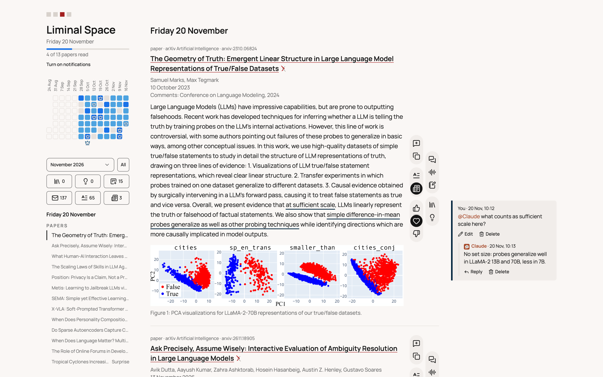
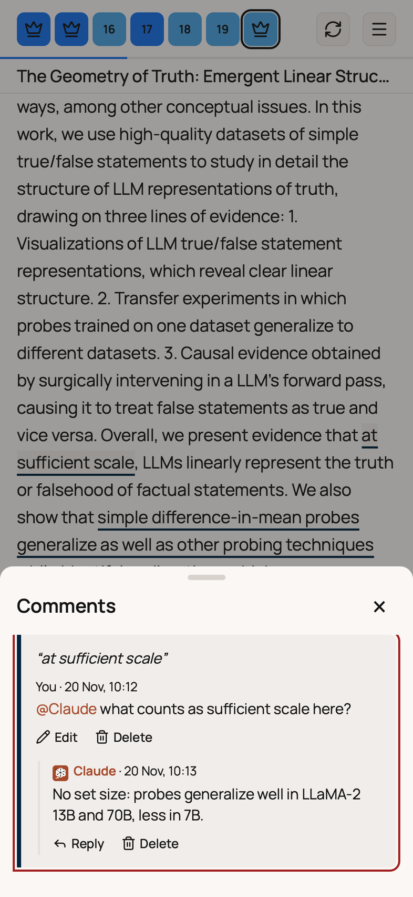

# 📖 Liminal space

<p>
  
  
</p>

Liminal space is a personal research feed. Every morning an AI agent, the scout, searches arXiv, this year's conference acceptance lists and the news for a short list of topics, and adds what it picks to a web page. The owner reads the page in a browser or on a phone, marks it up, and asks Claude about any entry. Claude then reads the paper's full text and discusses it.

The page has two views. Feed holds the days' entries. Selected holds the papers the owner marked as having shaped their thinking, grouped by their main OpenAlex topic, each with the owner's note. The public page opens on Selected and the owner's copy on Feed.

A day's digest holds:

- at least ten papers on the interested topics,
- one "surprise" paper from outside AI that a science outlet such as Quanta Magazine or Nature wrote about,
- two or three news stories, articles or reports that the scout picks,
- every new post from the blogs and feeds listed in [`feeds.json`](feeds.json).

The topics, search phrases and conferences are in [`interests.md`](interests.md), which a person edits by hand.

The feed is built for one reader. Anyone can read it at [ivan.wiryadi.com/liminal-space](https://ivan.wiryadi.com/liminal-space/).

## Why

This is an attempt to gamify my own reading, that I should at least make a habit of reading up some papers abstract and be aware of current research. 

It is also a side project for building software with agents and models: an agent picks the papers, a second model scores the candidates, and agents wrote the code under a person's direction ([How it was built](#how-it-was-built)).

## How it works

<picture>
  <source media="(prefers-color-scheme: dark)" srcset="docs/how-it-works-dark.svg">
  
</picture>

## Architecture

The site runs on the free plans of two services. GitHub Actions for the daily search and the builds. Cloudflare serves the page and keeps the data.

The two diagrams show the same parts. The first follows an entry into the site, and the second follows a reader.


## Why Cloudflare and GitHub Actions

So it's free. 

## How it was built

Claude Code.

## Development

You need Node.js 26 (`.nvmrc`) and pnpm 12. To see the page with the public site's entries, install the dependencies:

```bash
pnpm install --frozen-lockfile
```

Then copy the public site's entries and start the preview:

```bash
node scripts/deploy/sync.ts pull site/digests.js && pnpm run preview
```

The page is then at `http://localhost:8787/liminal-space/`. [`CLAUDE.md`](CLAUDE.md) has the commands, the layout of the code, the tests and the branches. Each commit runs Biome, shellcheck and gitleaks through [pre-commit](https://pre-commit.com), and a type check when TypeScript changes. Run `pre-commit install` once per clone.

The code is written for one site, so a copy needs its addresses changed before it runs. Issues are welcome. Bug fixes are likely to be merged, but pull requests that change what the tool does are not.

MIT licence ([`LICENSE`](LICENSE)).
